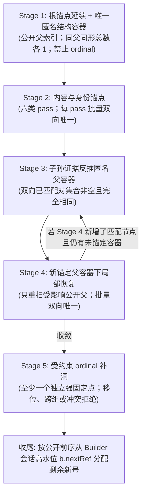

# 议题 2：跨帧节点引用稳定映射（Ref Continuity）

状态：提案，未实现。
基准提交：`6ec25c87daefbc01c99f78d968214304641d119d`
所属总览：[README.md](README.md)

## 1. 问题诊断与源码归因

在长列表滚动、瀑布流刷新、卡片展开/收起等场景中，页面上**原本就存在的卡片容器及其内部按钮/文本**（如信息流中的第 2、3、4 张卡片上移到第 1、2、3 位）在具备独立唯一身份证据时应保持原有的 `nXX` 节点引用号，这样：
1. `diff.go` 可以直接将其识别为存续节点，只输出父节点 `children` 列表变化或局部属性修改，从而产出紧凑的 `delta`；
2. Agent 在阅读前后两帧树时，能够直观看到哪些卡片是上一帧存续下来的，哪些是新滚入视口的。

以下“现状”均指基线提交中的实现；阶段、索引与谓词是本提案的待实现设计。静态反例属于设计推演，不等于已经执行单测或实机验证。

现行 [internal/observation/match.go](../../../internal/observation/match.go) 的组合存在两处根因，导致列表只要发生 1 个元素的位移，整屏容器和控件就可能发生错位漂移甚至全量重分配：

### 1.1 局限一：`signature()` 在存在 `resource-id` 时抹除了 `label` 特征

现行 `signature()` 位于 [internal/observation/match.go:77-102](../../../internal/observation/match.go#L77-L102)：

```go
func signature(raw *device.RawNode, role protocol.Role) matchKey {
	key := matchKey{
		role:     role,
		class:    raw.ClassName,
		pkg:      raw.Package,
		actions:  actionsMask(raw),
		editable: role == protocol.RoleInput,
	}
	if raw.ResourceSet && raw.ResourceID != "" {
		key.resource = raw.ResourceID
		key.hasRes = true
	}
	if raw.HasPassword && raw.Password {
		key.protected = true
	} else if role != protocol.RoleInput && !key.hasRes {
		key.label = labelSignature(labelParts(raw))
	}
	if role == protocol.RoleInput && raw.DescSet && !(raw.HasPassword && raw.Password) {
		key.anchor = raw.Description
	}
	return key
}
```

**后果分析**：
- 在真实的原生 Android App（使用 `RecyclerView` / `ListView` + XML 布局模板）中，列表每一行卡片内部的标题、作者、价格、按钮通常都带有相同的编译期视图 ID，例如：
  - 卡片 1 的标题：`resource="com.app:id/tv_title"`, `text="商品 A"`
  - 卡片 2 的标题：`resource="com.app:id/tv_title"`, `text="商品 B"`
  - 卡片 3 的标题：`resource="com.app:id/tv_title"`, `text="商品 C"`
- 因为 `raw.ResourceID != ""`，`!key.hasRes` 为 `false`！`signature()` **直接丢弃了 `"商品 A"`、`"商品 B"`、`"商品 C"` 的 `key.label`**！
- 结果这 3 个标题节点的 `matchKey` 在 identity 字段上完全相同：`role`、`class`、`pkg`、`resource`、`label=""` 均相同。
- 现行全局 Pass 3 通过 `hasIdentity()` 与 `sameUnit()` 统计候选，见 [match.go:367-385](../../../internal/observation/match.go#L367-L385)。由于身份桶内有 3 个旧节点和 3 个新节点，标题无法唯一匹配，匿名卡片容器也就少了一条可用的后代证据。

### 1.2 风险二：`Pass 1` 在内容匹配前盲目按同形状兄弟序号（`ordinalSibling`）抢配匿名容器

现行容器 pass 位于 [internal/observation/match.go:291-335](../../../internal/observation/match.go#L291-L335)：

```go
if countCurrentSiblings(childrenOf, curSig, parentOf[i], curSig[i]) == 1 {
	if len(candidates) == 1 {
		match(i, candidates[0].ref, candidates[0].position)
		matchedNow++
		continue
	}
	if ref, pos, ok := classCandidate(candidates, curSig[i]); ok {
		match(i, ref, pos)
		matchedNow++
	}
	continue
}
if ref, pos, ok := ordinalSibling(prev, usedPos, childrenOf[parentOf[i]], curSig, anchor, i, sameShape); ok {
	match(i, ref, pos)
	matchedNow++
}
```

其中 [ordinalSibling()](../../../internal/observation/match.go#L539-L570) 在旧、新同形兄弟数量相等时，按前序序号返回候选：

```go
if len(candidates) != sameShapeCount || len(candidates) == 0 || rank >= len(candidates) {
	return "", 0, false
}
unit := candidates[rank]
if usedPos[unit.position] {
	return "", 0, false
}
return unit.ref, unit.position, true
```

**后果分析（序号错位雪崩）**：
1. 假设列表容器 `scroll (n2)` 下可见 5 张匿名卡片容器 `group`（旧帧为 `Card_A(n10), Card_B(n20), Card_C(n30), Card_D(n40), Card_E(n50)`）。
2. 用户向下滚动一格，`Card_A` 滚出屏幕，`Card_F` 滚入屏幕底部。当前帧 `scroll (n2)` 下仍然是 **5 张匿名卡片容器**（`Card_B, Card_C, Card_D, Card_E, Card_F`）。
3. 现行容器 pass 在**完全不看卡片内部子孙节点内容**的情况下，发现旧、新同形容器数都为 5，于是调用 `ordinalSibling` 按序号 `0..4` 强行配对：
   - 当前帧第 0 张卡片（实际是 `Card_B`）被强行冠上了旧帧第 0 张卡片 `Card_A` 的引用 **`n10`**！
   - 当前帧第 1 张卡片（实际是 `Card_C`）被强行冠上了 `Card_B` 的引用 **`n20`**！
   - ……依此类推，5 张卡片容器的 `nXX` **全部张冠李戴**！
4. 更糟糕的是，随后的 `Pass 2`（同父节点下 `sameUnit` 匹配）和 `Pass 5`（同父节点下 `samePublic` 匹配）要求候选位于当前已匹配父锚点下。基线保存的是旧公开前序位置 `anchorPos`，不是字符串 ref；下面的 `nXX` 只用于指认节点：
   - 当前 `Card_B` 容器已被错配成 `Card_A` 的 ref `n10`，所以其子节点的 `prevParent[parent]` 是旧 `Card_A` 的位置。若标题带各卡共享的 resource，签名又不含唯一文本，局部 Pass 2 会把 `Card_B` 标题错配给旧 `Card_A` 标题 `n11`，并非只能新号；全局 Pass 3 也无法用完整树中的重复资源键找回真实 `n21`；若标题没有 resource、文本全局唯一，Pass 3 虽能找回 `n21`，该标题的公开父仍然错成 `n10`；
   - `Card_B` 内部的 `"收藏"` 按钮在各卡片间重复，无法全局唯一。由于所在容器的父锚点已错成旧 `Card_A` 的位置，局部 Pass 2 会在旧 `Card_A`（已滚出屏幕）的公开直接子节点中寻找同形 `"收藏"` 按钮，并把 `Card_A` 的按钮 ref **`n12`** 错配给 `Card_B` 的按钮；基线相关锚点检查见 [match.go:343-358](../../../internal/observation/match.go#L343-L358) 与 [match.go:428-443](../../../internal/observation/match.go#L428-L443)。
5. **最终灾难**：
   - `Card_B` 的外层卡片容器变成了 `Card_A` 的 `n10`，收藏按钮变成了 `Card_A` 的 `n12`；带 resource 的标题也错拿旧 `Card_A` 的标题 ref，而无 resource 的唯一标题会以 `n21` 跨父挂到 `n10`。两种分支都撕裂了同一张卡片内部的连续性。
   - 对无 resource 标题分支，`diff.go` 会看到 `n21` 从旧父 `n20` 迁到 `n10`；对共享 resource 标题分支，即使容器错配，标题也失去本可保留的内容证据。若新滑入卡片再触发差分的跨父/删除限制，输出会进一步退化为 `full`。

---

## 2. 方案设计：完整语义签名 + 五阶段双向锚定流水线（路线 B1）

为降低上述两类风险，并在证据足够时保持单节点文本更新的引用连续性（例如同一容器下唯一的 `@+id/fav` 按钮从 `"收藏"` 变为 `"已收藏"`，或者计数器从 `"12"` 变为 `"13"` 时仍保持原 `nXX`），我们对 `signature()` 和 `matchRefs()` 进行系统性重构。

### 2.1 修复身份签名：保留有资源节点的 `label`，分离输入/内容/公开身份规则

#### 2.1.1 继续使用现行 `matchKey`，明确字段来源与三态规则

基线代码已经使用 `matchKey`。字段与生成逻辑见 [internal/observation/match.go:44-102](../../../internal/observation/match.go#L44-L102)。本提案扩展原结构，不引入另一套节点签名。

原始字段的“已知/未知”规则直接来自 [internal/device/types.go:79-118](../../../internal/device/types.go#L79-L118)：

- 只有 `raw.ResourceSet && raw.ResourceID != ""` 才令 `hasRes=true`。`ResourceSet=false` 与“显式报告空资源”都不能被推断为某个可见资源身份。
- 保护态只用 `raw.HasPassword && raw.Password`；不得直接读取可能未上报的 `raw.Password` 单独作判据。
- `tap/long_press/text/swipe` 分别只由 `HasClickable/Clickable`、`HasLongClick/LongClickable`、`Editable`、`HasScrollable/Scrollable` 产生。未知能力不转成默认 `false` 或默认 `true`；进入 identity 的是已经投影的 action mask。
- 普通 label 只取 `TextSet && Text != ""` 和 `DescSet && Description != ""` 的非空部分；描述作为输入锚点也只在 `DescSet` 时可用，保护输入不把描述或文本当作公开内容身份。基线 `labelParts()` 见 [build.go:345-360](../../../internal/observation/build.go#L345-L360)。
- 非输入、非保护的文本/描述 label 在存在 resource ID 时也保留。resource 回答“这是模板里的哪个字段”，label 回答“当前是哪一条内容”，两者承担不同作用。

计划中的 `signature()` 保持现行函数形态：

```go
func signature(raw *device.RawNode, role protocol.Role) matchKey {
	key := matchKey{
		role:     role,
		class:    raw.ClassName,
		pkg:      raw.Package,
		actions:  actionsMask(raw),
		editable: role == protocol.RoleInput,
	}
	if raw.ResourceSet && raw.ResourceID != "" {
		key.resource = raw.ResourceID
		key.hasRes = true
	}
	if raw.HasPassword && raw.Password {
		key.protected = true
	} else if role != protocol.RoleInput {
		key.label = labelSignature(labelParts(raw))
	}
	if role == protocol.RoleInput && raw.DescSet && !(raw.HasPassword && raw.Password) {
		key.anchor = raw.Description
	}
	return key
}
```

`labelParts()` 对保护输入继续返回空，对普通文本仍按“文本、不同描述”的固定顺序编码。`protocol.RoleInput` 使用正式角色常量，不再以字符串字面量比较。

#### 2.1.2 `hasIdentity()` 负责资格，`sameUnit()` 负责显式字段等价

现行 [hasIdentity()](../../../internal/observation/match.go#L488-L499) 已经按角色区分身份资格：输入框可由 class、resource 或非空描述提供资格；普通节点要求 resource 或 label；保护节点可单独构成身份。这个资格规则继续保留。

基线 [sameUnit()](../../../internal/observation/match.go#L665-L671) 比较 role、class、package、resource presence/value、label 与 protected，**没有比较 actions、editable 或 input anchor**。同父 Pass 2 还会用 `countCurrentIdentitySiblings()` 要求当前侧同键候选恰为一个，因此一个无 resource、无描述的 EditText 只要在已匹配父节点下旧、新两侧各只有一个，现行测试就会保号；两个同 class 输入则全部不保号。基线证据见 [match.go:338-358](../../../internal/observation/match.go#L338-L358) 与 [continuity_test.go:86-101](../../../internal/observation/continuity_test.go#L86-L101)。

计划中的 `sameUnit()` 使用显式字段表，避免旧草案的 `a == b` 隐式包含未来字段，也避免基线漏掉 actions、editable 与 input anchor：

```go
func sameUnit(a, b matchKey) bool {
	return a.role == b.role &&
		a.class == b.class &&
		a.pkg == b.pkg &&
		a.hasRes == b.hasRes &&
		a.resource == b.resource &&
		a.label == b.label &&
		a.anchor == b.anchor &&
		a.actions == b.actions &&
		a.editable == b.editable &&
		a.protected == b.protected
}
```

全局规则另外使用下面的作用域守卫；它不改变同父 Pass 2 对无锚点 input 的接受：

```go
func eligibleForGlobalExact(k matchKey) bool {
	if !hasIdentity(k) {
		return false
	}
	if k.editable {
		return k.hasRes || k.anchor != ""
	}
	return true
}
```

调用点仍先执行 `hasIdentity(a) && hasIdentity(b)`。全局精确 pass 另需执行 `eligibleForGlobalExact()`；它允许普通身份节点以及带 resource 或非空描述锚点的 input，但排除“仅凭 class 获得资格”的无锚点 input。因此：

- 有唯一 class 的无资源、无描述 EditText 仍可在已锚定父节点下按 `sameUnit` 保号。现行逻辑正是由 Pass 2 完成这一点，见 [match.go:338-365](../../../internal/observation/match.go#L338-L365)；不能把 `resource/label` 守卫写进 `sameUnit` 本身。
- 两个同 class 的无锚点输入框在同一父节点下会形成两侧各 2 个候选，必须全部不匹配；不能因遍历先后让第一个输入框抢走唯一旧 ref。
- 唯一但跨父的无锚点 input 也不能由全局 Pass 3 配对；只有同父 Pass 2 的完整单元唯一规则可以接受它。
- 输入值不进入 `matchKey`。资源或非空描述继续由专用输入锚点规则帮助跨值修改保号。

#### 2.1.3 输入匹配沿用现行分层，并明确无锚点边界

现行输入行为需要按以下顺序保留：

1. **同父 Pass 2 精确单元**：无资源、无描述输入框由 role/class/package/resource presence、label、anchor、actions、editable、protected 的完整字段在已匹配父节点下双向唯一匹配。基线对应逻辑不考虑 actions/anchor，本提案补齐；现有 [TestContinuityInputValueChangeWithoutAnchorKeepsRef](../../../internal/observation/continuity_test.go#L86-L101) 覆盖“单个输入框值修改后仍保号”。
2. **同父 Pass 4 输入锚点**：基线 [sameInputAnchor()](../../../internal/observation/match.go#L674-L688) 要求 role/class/package/protected 一致；两侧都有 resource 时比较 resource，两侧都无 resource 时要求非空描述相同。提案再要求 actions 相同；用户输入值仍不进入身份。
3. **无锚点兜底不算全局身份**：没有 resource、没有非空描述且 class 相同的输入框，只能在同一已匹配父节点内按完整 shape 双向唯一时保号。候选数任一大于 1，全部放弃，不引入坐标或遍历优先。

提案会把 `actions` 纳入 exact/input/public 比较，以符合正式契约 [docs/architecture.md:274-278](../../../docs/architecture.md#L274-L278) 的身份维度。保护态或已公开动作变化改变 identity，不允许只凭 resource 复用旧 ref。无锚点 input 的例外只放宽“是否需要描述/resource 才能在**同父**下识别”，不放宽全局作用域。

同父输入锚点 pass 的计划判定为：

```go
func sameInputAnchor(a, b matchKey) bool {
	if a.role != protocol.RoleInput || b.role != protocol.RoleInput {
		return false
	}
	if a.class != b.class || a.pkg != b.pkg ||
		a.actions != b.actions || a.protected != b.protected {
		return false
	}
	if a.hasRes && b.hasRes {
		return a.resource == b.resource
	}
	if a.hasRes != b.hasRes {
		return false
	}
	return a.anchor != "" && a.anchor == b.anchor
}
```

#### 2.1.4 `sameResourceOnly()`：只退让 label

资源 ID 在 RecyclerView 模板中通常只标识“这一行里的某个字段”，不是跨行实例 ID。因此 resource-only 退避只用于已锚定父节点内，并只允许 label/计数变化：

```go
func sameResourceOnly(a, b matchKey) bool {
	if a.editable || b.editable || !a.hasRes || !b.hasRes {
		return false
	}
	return a.role == b.role &&
		a.class == b.class &&
		a.pkg == b.pkg &&
		a.resource == b.resource &&
		a.actions == b.actions &&
		a.protected == b.protected
}
```

该谓词不跨父全局使用，也不用于输入框。它仍要求旧、新两侧在已锚定父节点的同一候选桶中各只有 1 个未匹配成员；存在重复 resource、跨父移动或 action/protected 变化时，此 pass 放弃匹配；其它独立强证据规则仍按各自资格运行。

#### 2.1.5 公开身份回退补齐 actions

现行 [publicSignature()](../../../internal/observation/match.go#L140-L158) 只保存公开 role、label、resource、anchor、editable、protected；[samePublicUnit()](../../../internal/observation/match.go#L656-L663) 也没有比较 actions。这与正式文档的身份维度不一致。提案计划让 `publicKey` 携带已投影 action mask，并由 `samePublicUnit()` 比较该字段。

```go
type publicKey struct {
	role      protocol.Role
	label     string
	resource  string
	hasRes    bool
	anchor    string
	actions   uint8 // actionsMask(raw), only projected action bits
	editable  bool
	protected bool
}

func samePublicUnit(a, b publicKey) bool {
	return a.role == b.role &&
		a.label == b.label &&
		a.hasRes == b.hasRes &&
		a.resource == b.resource &&
		a.anchor == b.anchor &&
		a.actions == b.actions &&
		a.editable == b.editable &&
		a.protected == b.protected
}
```

`hasPublicIdentity()` 仍只以 positive protection、公开非空 resource 或非空 label 作为资格；新增 actions 用于已经获得资格的两个公开候选做等价比较，不把“所有匿名可点击容器都是同一身份”扩大成新的保号入口。

该修正只影响隐藏 raw class/package 或未公开 resource 的保号回退，不把所有状态位都塞进身份：value、checked、focused、selected、enabled 和 bounds 仍按各自语义处理。

#### 2.1.6 同批次双向唯一，禁止先到先得

content/input/public pass 都使用批量规则，但“唯一”的统计宇宙必须按 pass 的作用域分别为局部未匹配集合或完整公开树。二者不能混用：

1. 以本次 pass 开始时的匹配快照确定哪些端点尚未使用；后续 step 的即时结果不能改变本 pass 的候选语义。
2. **同父 pass（Pass 2、2b、4、5）使用 `localUnmatchedUniverse`。** 作用域是已匹配公开父节点；旧桶 `P` 只收集该父节点在 pass 开始时尚未匹配的旧直接子节点，当前桶 `C` 只收集对应父节点在 pass 开始时尚未匹配的当前直接子节点。只有两侧各 1 个且合资格时才配对。Pass 2b 的 resource fallback 明确采用这一受限语义：它的证据是“已锚定的父 + 父内剩余候选唯一”，不是跨树全局唯一。
3. **全局 pass（Pass 3、6）使用 `globalFullUniverse`。** 分别扫描**整棵**旧、当前公开树中所有合资格节点，matched 与 unmatched 都计入。桶的基数必须由这个完整集合决定；不得先剔除已匹配节点再统计。只有完整旧桶 `P` 和完整当前桶 `C` 都恰有 1 个成员，并且这两个唯一端点都仍未被使用时，才记录配对。此时候选自然唯一与端点可用两个条件必须同时成立。
4. 任一桶为空、两侧数量不等、任一侧大于 1，或完整唯一端点已匹配，该桶整体不产生全局 proposal。先完成本 pass 全部判定，再一次性应用；同一 pass 内较早 proposal 不得改变较晚桶的基数，也不得令其它节点“变唯一”。
5. 应用前统一重验一个旧节点至多配一个当前节点、一个当前节点至多配一个旧节点；任一冲突撤销整批 proposal。

这条规则同时替代“扫描到第一个候选就 match”的实现方式。遍历顺序只影响日志和最终新号分配顺序，不影响旧 ref 的归属。Pass 2b 与 Pass 3/6 的差异是刻意保留的边界：局部 parent anchor 可以证明“该父节点里只有一个同类剩余项”；一旦规则声称跨父或整树唯一，就必须把此前已由局部 pass 消耗的重复模板也计入完整桶。局部消耗不得把原始 `2 → 1` 的重复模板改写成全局唯一。

**为什么这样设计能做到两全其美？**
1. **列表复用场景（跨父/全局区分）**：5 行标题共享 `resource="app:id/tv_title"`，但 label 分别为 `"帖子甲"`、`"帖子乙"` 等；完整 key 让每个唯一 `(resource, label)` 在全局形成单元素旧、新桶，可在祖先容器尚未锚定时先建立内容证据。
2. **动态文案/状态变更场景（同父退避保持引用）**：收藏按钮从 `"收藏"` 变成 `"已收藏"`，或计数从 `"99"` 变成 `"100"` 时，先由精确 pass 消耗未变化兄弟，再由 resource-only pass 在已锚定父节点内要求旧、新未匹配桶各 1 个。actions/protected 或结构上下文有任何冲突都不退让。

---

### 2.2 重构 `matchRefs`：五阶段双向锚定流水线

我们将原本单一的“从上到下盲目配容器 -> 从下到上配叶子”改为**“唯一容器 -> 全局/同父内容锚定 -> 子孙证据反推匿名容器 -> 锚定容器内局部兄弟恢复 -> 零位移约束下的同序号兜底”**五阶段流水线。



下面详细说明每个阶段的精确算法与边界条件。

#### 公共索引与术语

匹配全部发生在**公开投影树**上，而不是 raw 直接父子关系上。现行实现已经先用 `preorder(cap)` 保留 `units[i].published` 节点，再用 [nearestPublishedParent()](../../../internal/observation/match.go#L590-L610) 跳过未发布 raw 祖先，见 [match.go:212-225](../../../internal/observation/match.go#L212-L225)。提案复用同一语义，并为新旧帧建立：

- `order`：公开节点前序；
- `parent`：公开直接父；
- `children`：公开直接子；
- `tin/tout`：公开子树的 Euler 区间；
- `refAt/posByRef`：公开节点与 ref/位置的互查；
- `keyAt/publicAt`：`matchKey/publicKey`；
- `matchByPrev/matchByCur`：只增不减的一对一已匹配关系，附 `matchSource` 证明来源。

`anonymousContainer(c)` 明确定义为：公开节点不是 root、不是 input、`hasPublicIdentity(publicAt[c]) == false`，且按分册 01 的源头不变式至少有一个公开子节点。匿名 action 容器仍由 `sameShape` 比较其 class/package/action/protected。

Stage 1、Stage 2、Stage 4 的每个 pass，以及 Stage 3/5 的每个 proposal batch，都使用同一批处理原则：先快照、再整批做双向独占判定、最后原子应用。局部结构 pass 按父内全部同形兄弟计数；Stage 2/4 的局部身份 pass 只按 pass 起始未匹配直接子计数；Pass 3/6 则按完整公开树的全部合资格节点计数。无论统计宇宙为何，只有旧、新两侧恰好 1 个且端点仍可用才配对；集合等式不满足、端点冲突或预算未完成时也不得部分提交，不按遍历顺序抢占。

#### Stage 1：唯一结构容器自顶向下匹配（`matchUniqueContainers`）

合成 root 是“当前显示”的阅读单元，不是应用节点。只要 previous snapshot 存在，就在任何形状匹配之前无条件令 `refs[cap.Root] = prev.root.Ref`，并令当前 root 的 previous 父位置指向 previous root；现行实现见 [match.go:266-279](../../../internal/observation/match.go#L266-L279)。raw root 的 class/package 形状变化不得令合成 root 换号。

其余节点按公开 `order` 自顶向下处理：

1. 当前节点 `c != cap.Root` 必须是匿名容器，且其公开父 `curParent` 已有 previous 父锚点 `anchorPos`。
2. 在旧、新两侧都从**全部**公开直接子节点中选取 `anonymousContainer`，不使用“尚未匹配后只剩一个”来制造唯一性，也不把有公开身份的容器塞进 shape 桶。
3. 以 `shapeKey` 分组。`shapeKey` 必须等价于 `sameShape`，不能直接使用包含隐藏 class/package/resource 的精确 `matchKey`。
4. 只有当 `|prevShapeSiblings(anchorPos, shapeKey)| == 1` 且 `|curShapeSiblings(curParent, shapeKey)| == 1` 时，才记录配对。
5. 本 pass 不调用 ordinal。这样唯一骨架可先锚定，而列表下的多张同构卡片继续等待内容或子孙证据。

#### Stage 2：内容与身份锚点匹配（`matchContentPasses`）

对尚未匹配的节点依次运行以下 pass；每个 pass 完全结束后，后续 pass 才看到新匹配：

1. **Pass 2（同父精确）**：使用 `localUnmatchedUniverse`，以已匹配公开父节点为作用域，以完整 `sameUnit()` 为桶键。两侧在 pass 开始时未匹配的桶各 1 才配对。无资源、无描述输入框依靠 `hasIdentity()` 的 input 分支进入此 pass；多个同 class 输入框不能先到先得。
2. **Pass 2b（同父资源退避）**：使用 `localUnmatchedUniverse`，仍以已匹配公开父节点为作用域，仅对非 input、有 resource 的节点使用 `sameResourceOnly()`。只允许 label/计数变化，actions/protected/class/package/resource 任一变化都不匹配；两侧在 pass 开始时未匹配的桶各 1 才配对。
3. **Pass 3（全局精确）**：使用 `globalFullUniverse`，以完整 `sameUnit()` 为桶键，但只接受满足 `eligibleForGlobalExact()` 的节点；class-only、无 resource、无描述锚点的 input 不进入全局桶。基数来自整棵旧/当前公开树中的全部合资格节点，matched 也计入；只有完整旧、新桶各 1 且两个唯一端点都尚未匹配才配对。带相同 resource 的标题因保留 label 可形成唯一内容证据。
4. **Pass 4（Input 锚点）**：使用 `localUnmatchedUniverse`，以已匹配公开父节点为作用域，对 input 使用 `sameInputAnchor()`。两侧有 resource 时比较 resource；两侧都无 resource 时只接受相同的非空描述。无 resource/描述的输入框已由 Pass 2 的同父完整单元规则处理，不在全局凭 class 猜配。
5. **Pass 5（同父公开身份回退）**：使用 `localUnmatchedUniverse`，以已匹配公开父节点为作用域，以补齐 actions 后的 `samePublicUnit()` 为桶键；两侧在 pass 开始时未匹配的桶各 1 才配对。
6. **Pass 6（全局公开身份回退）**：使用 `globalFullUniverse`，使用同一公开身份键扫描整棵旧/当前公开树；只有完整旧、新桶各 1 且两个唯一端点都尚未匹配才配对。

Pass 2、2b、4、5 的“未匹配各 1”只描述已锚定父内部的受限证据；Pass 3、6 的“唯一”必须来自完整公开树，不能因为之前的局部 pass 已消耗重复模板中的一个，就把剩余节点当成全局唯一。所有 pass 的端点可用性都取各自 pass 开始快照，处理过程中的先到先得不能改变这一点。

#### Stage 3：基于已匹配子孙的“全票无冲突证据”自顶向下反推匿名父容器（`matchContainersByDescendants`）

当 Stage 2 完成或 Stage 4 产生新锚点后，令当时的一对一已匹配关系为只读快照：

```text
R = {(oldPos, curIdx) | oldPos 与 curIdx 已一对一匹配，且 matchSource ∈ {Stage1, Stage2, Stage3, Stage4}}
```

`matchSource` 是本提案新增的内部证明来源标记，不是公开字段。Stage 5 之后再次运行 Stage 4 时，来源可记为 `postOrdinalLocal`；它不能被反向用于 Stage 3。对未匹配匿名容器 `c`，其公开父锚点为 `A = prevParent[curParent]`。在公开子树的 Euler 区间上定义：

```text
R_c = {(oldPos, curIdx) ∈ R | curIdx ∈ publicSubtree(c)}
R_p = {(oldPos, curIdx) ∈ R | oldPos ∈ publicSubtree(p)}
```

对每个候选 `(c, p)`，全票条件统一为：

```text
R_c ≠ ∅ 且 R_c == R_p
```

比较的是完整匹配对集合，不是已匹配子节点数量、单个“直接子祖先”或某一侧的集合。因而以下任一情况都会使等式失败或候选资格失败：

1. `c` 已匹配、`p` 已使用，或 `c`/`p` 不满足 `anonymousContainer`。
2. `c` 不是当前公开父 `curParent` 的直接子节点，或 `p` 不是旧公开父 `anchor` 的直接子节点。
3. `c` 内没有任何 `R` 中的匹配对；空集合永远不能投票。
4. `R_c` 中存在旧端点不在 `anchor` 子树内的跨父/跨区域匹配，或存在无法归到某个直接旧子容器的端点。
5. `R_c` 的旧端点分别落入多个旧直接子容器，形成候选分裂。
6. 选定唯一候选 `p` 后，`R_c != R_p`：方向缺失说明旧 `p` 的证据被拆到别处，方向多余说明 `p` 还有其他匹配落入其它当前容器。
7. `p` 的 ref 或 `c` 的 ref 被另一 proposal 反向占用，形成一对多；同一 batch 内任一端点冲突即不应用该冲突组。
8. `sameShape(pKey, cKey)` 不成立。形状分组使用与 `sameShape` 等价的归一化 `shapeKey`，不能使用完整 `matchKey`。

实现时先从 `R_c` 的旧端点按“`anchor` 的直接子容器”聚合候选。要求恰有一个 `p`，再比较 `R_c == R_p`；不得只验证“所有当前已匹配子孙都指向同一个 p”，因为那会漏掉旧 `p` 子树中已被匹配到别处、或落在当前容器外的节点。匹配对 reverse map 也必须同时检查，保证 `p` 未被其它当前节点占用。

Stage 3 不能在前序循环中遇到一对就立刻改 `R`；否则先匹配的容器会改变后续容器的候选集合并重新引入遍历顺序。每轮先从同一 `R` 快照构造全部 proposal，按公开前序确定 proposal 顺序，再做双向独占检查并原子应用。新匹配的容器进入 Stage 4 的 dirty queue；其子容器只有在父容器已经落入已提交的上一轮或本轮结果后，才可能成为下一轮候选。

这条规则同时处理 split/merge：旧容器 `p` 的两个匹配后代若在新帧落入两个不同当前容器，两组都无法得到 `R_c == R_p`；两个旧容器若合并进一个新容器，`R_c` 的旧端点会落入多个候选 `p`。扫描顺序、剩余唯一性或旧的“先匹配外层、内层自然顺延”都不能把这些情况变成保号证据。

#### Stage 4：新锚定父容器下的局部兄弟恢复（`matchLocalUnderAnchoredParents`）

当 Stage 3 将卡片容器锚定回旧父后，卡片内部那些“全屏重复、但在单张卡片内部唯一”的按钮、图标和匿名子容器才第一次拥有可用的公开父锚点。Stage 4 用 dirty queue 处理这种新出现的局部证据：

1. 队列元素是当前公开父节点 `curParent`，其 `prevParent[curParent]` 必须有旧公开位置 `anchor`。
2. 初始种子是 root，以及此前各 pass 新匹配、且仍有公开子节点的父节点。一个 pass 新增匹配后，把新匹配且仍有子节点的当前节点加入队列。
3. 对队列中所有父节点按以下固定顺序运行局部 pass。每个 pass 都以 pass 开始时的一对一状态为快照，按同时覆盖整个 dirty queue 的 `(curParent, key)` 桶一次判定并原子应用：
   - Local-Structure：与 Stage 1 相同，统计该父节点**全部**公开直接匿名容器；同一 `sameShape` 等价桶在旧、新两侧都恰好 1 个，且两端尚未匹配时才能配对。不能只统计“尚未匹配后剩下的容器”；
   - Local-Exact：两侧未匹配节点中 `sameUnit` 桶各 1 个才配对；
   - Local-Resource：两侧未匹配节点中 `sameResourceOnly` 桶各 1 个才配对；
   - Local-Input：两侧未匹配节点中 `sameInputAnchor` 桶各 1 个才配对；
   - Local-Public：两侧未匹配节点中补齐 actions 的 `samePublicUnit` 桶各 1 个才配对。
4. 一个 pass 完成后才允许后续 pass 看见新匹配；同一 pass 内不得因“已经消耗了一个候选”而把剩余节点当作唯一。
5. Local-Structure 尤其不能用内容 pass 后只剩 `Card_A` 与 `Card_F` 这一事实把滚动后的首尾配成同类；Stage 5 的独立固定点才是列表剩余项的唯一弱结构入口。
6. 桶键必须包含当前父节点。全局 Pass 3/6 不在 Stage 4 重跑；否则“父锚定后的局部恢复”会悄悄退化成跨父全局扫描。

Stage 3 与 Stage 4 交替到 `R` 不再增加为止。实现可以按深度层推进，也可以从新锚点用 dirty queue 扩散；不能假设“两三轮必然收敛”。理论上每个接受过的匹配只发生一次，所以节点有限时循环会终止，但收敛轮数最坏仍与公开树深度有关，实际工作必须计入下面的确定性预算。

#### Stage 5：零位移证据约束下的同序号兜底（`matchOrdinalContainersZeroShift` + 最终局部恢复）

Stage 5 是最后、最弱的补洞规则。只有 Stage 1~4 已稳定仍留下的同形匿名兄弟组才进入 Stage 5，而且 ordinal 本身绝不能生产自己的证据。Stage 5 不直接按序号配对 input、label-bearing 节点或带公开身份的子控件；这些节点只能在容器已有独立强固定点、两条同 rank 容器配对成功后，再由局部恢复按各自唯一证据处理。

对每个已匹配父 `curParent` 和 `anchor := prevParent[curParent]`，定义：

```text
prevSibs = anchor 的全部公开直接匿名子容器按公开顺序分组后、某一 shapeKey 桶
curSibs  = curParent 的全部公开直接匿名子容器按公开顺序分组后、同一 shapeKey 桶
```

`shapeKey` 必须与 `sameShape` 等价：role、actions、protected 相同；非 action 容器可忽略未公开 class/package，action 容器还要求 class/package 相同。筛选的是**全部**公开直接匿名子容器，不能误读 raw `Parent/Children`，也不能把“当前尚未匹配的节点”重新编号成 0..K-1 后当作真实序号。

一个组被 Stage 5 接受（缺一不可）：

1. `len(prevSibs) == len(curSibs) == K`，且 `K > 1`。
2. 令 `baseR` 为进入 Stage 5 前的只读匹配快照，来源不得是 ordinal。
3. 至少存在一个 `r`，使 `(prevSibs[r], curSibs[r]) ∈ baseR`。这个同序号对是**独立强固定点**：它在 Stage 5 之前由唯一形状、内容、输入/公开身份、同父局部恢复或全票子孙证据产生。
4. 任一组内旧、新节点若已出现在 `baseR` 中，其配对端点必须是同组同 rank 的对应项；出现跨 rank 的已匹配对，即视为移位。
5. 任一组内节点若在 `baseR` 中匹配到该 shape 桶以外的当前/旧节点，即视为跨组使用；一个端点的 reverse map 若不唯一或互相冲突，也拒绝。
6. 组内没有任何独立固定点时必须整组拒绝。全部未匹配、全同质重复内容、普通 A/B → C/D 全替换都落入此分支，所有剩余节点分配新 ref。

满足条件后，Stage 5 只为同 rank 且两侧都未匹配的 `(prevSibs[r], curSibs[r])` 构造 proposal。所有 shape 桶都从同一个 `baseR` 判定；一个桶刚由 ordinal 得到的配对不得成为另一个桶的固定点。全部 proposal 再按一对一关系原子应用；不得按 map 顺序或遍历先后逐对提交。

Stage 5 只运行一次。完成后允许重新运行 Stage 4 的局部恢复，使刚保号的容器能找回内部唯一子控件；不得重跑 Stage 3、把 ordinal 结果拿去反推其它祖先，也不得再运行 Stage 5。若某组有固定点但局部子节点仍有歧义，这些子节点保持未匹配并在收尾取新号。

#### 复杂度、确定性预算与安全截断

不能把该流水线称为严格 $O(N)$。令 `Np`、`Nc` 分别为旧、当前公开树节点数：

- 构建公开父、子、前序和 Euler 索引是 $O(Np + Nc)$，空间也是 $O(Np + Nc)$。
- 普通 hash-bucket pass 在均匀散列假设下期望 $O(Np + Nc)$；字符串哈希碰撞和桶比较仍需按实际比较工作计费。
- Stage 3 每轮遍历匹配对候选并检查 `R_c == R_p`；若实现未经索引而让每个容器扫描全部后代/候选，最坏会退化到二次级。Euler 区间、parent-scoped shape 桶、`matchByPrev/matchByCur` reverse map 只能减少实际工作，不能据此声称严格线性。
- Stage 3/4 的轮数与树深有关；固定 depth 上限不等于渐近 $O(N)$。

因此提案采用与节点数相关的**确定性工作量预算**初值，而不是墙钟超时：

```text
Wmax = 128 * (Np + Nc + 1) + 65_536
```

这是本提案选定的实现初值。当前层级制品限制为最大深度 50、单次最多 20,000 个 raw 节点，见 [hierarchy.go:15](../../../internal/android/hierarchy.go#L15) 与 [hierarchy.go:18](../../../internal/android/hierarchy.go#L18)；这些限制只用于给 `128` 和 `65_536` 选择保守余量，不能据此声称已证明 50 层传播的严格工作量上界。两棵 20,000 节点公开树达到上限时，公式给出约 5.18M 个确定性计费操作。该值没有经过性能实测，只通过可选匹配推断的停点控制保号率；初值偏低时结果是更多节点分配新号及更保守的 delta，初值偏高时是更多计算，二者都不能授权未经证明的 ref 复用。

预算只统计算法检查，例如“检查一个节点是否命中桶”“比较一对候选是否同键”“检查一个匹配对是否属于容器/区间”“校验一个 proposal 端点”。每次命中不在扫描中途修改映射；若当前 batch 在应用前耗尽预算，放弃这一整批，保留此前已原子提交的唯一匹配，然后停止所有可选推断。不得用墙钟、随机 map 顺序或后台超时决定截断点。

桶和 proposal 的遍历顺序由公开前序首次出现顺序决定，map 只做查找，不作为迭代顺序来源。测试记录剩余预算和枚举原因码；这些 `matchSource/budget` 仅用于内部测试或批准的事件计数，不进入公开树或日志正文。

预算耗尽时，root 的既有 ref 继续，随后按公开前序把所有剩余未匹配节点从 Builder 当前会话高水位 `b.nextRef` 分配新号。这个降级只降低保号率，不会把未证明候选挪给旧 ref；多余的新号会令 delta 更保守，但不会破坏 Ref 唯一性。`Candidate` 中被丢弃的构建本来就通过 [build.go:83-94](../../../internal/observation/build.go#L83-L94) 恢复旧 `prev/nextRef`，所以试探分配也不会污染后续发布树。

---

## 3. 核心算法伪代码（可直接对照落地 `internal/observation/match.go`）

```go
func (b *Builder) matchRefs(cap *device.Capture, units []unit, refs []string) {
	idx := buildPublicMatchIndex(cap, units) // order/parent/children/tin/tout/key/public
	st := newMatchState(idx, refs)
	budget := newWorkBudget(
		128*(idx.prevCount+idx.curCount+1) + 65_536,
	)

	allocate := func() string {
		ref := formatRef(b.nextRef)
		b.nextRef++
		return ref
	}
	assign := func(cur int, prevPos int, source matchSource) {
		st.assign(cur, prevPos, source)
	}

	if idx.prevRoot >= 0 {
		// Continue the synthetic root. The current root is cap.Root, not raw index 0.
		assign(cap.Root, idx.prevRoot, sourceRoot)
	} else {
		refs[cap.Root] = allocate()
		st.markCurAssigned(cap.Root)
	}

	dirty := newParentQueue()
	if hasPublicChildren(cap.Root) {
		dirty.push(cap.Root)
	}

	// Stage 1: unique anonymous structure under a matched public parent.
	matchUniqueContainers(st, budget, dirty)

	// Stage 2: six content/identity passes. Each pass snapshots first.
	matchContentPasses(st, budget, dirty)

	// Stage 3 finds container anchors; Stage 4 recovers only below those anchors.
	for !budget.exhausted() {
		before := st.matchCount()
		matchContainersByDescendants(st, budget, dirty)
		matchLocalUnderAnchoredParents(st, budget, dirty)
		if st.matchCount() == before {
			break
		}
	}

	// Stage 5 runs once; its proposals may not seed further ordinal buckets.
	if !budget.exhausted() {
		matchOrdinalContainersZeroShift(st, budget, dirty)
	}

	// After ordinal, only local child recovery is allowed.
	if !budget.exhausted() {
		drainLocalRecovery(st, budget, dirty)
	}

	// Safe degradation only allocates more new refs; it never reuses unproved refs.
	for _, cur := range idx.order {
		if refs[cur] == "" {
			refs[cur] = allocate()
			st.markCurAssigned(cur)
		}
	}
}
```

入口伪代码保留基线 [matchRefs()](../../../internal/observation/match.go#L181-L184) 的 Builder 方法及原地写 `refs` 形态。新号来自 [match.go:248-256](../../../internal/observation/match.go#L248-L256) 的 `b.nextRef`；root 延续见 [match.go:266-279](../../../internal/observation/match.go#L266-L279)。[build.go:83-94](../../../internal/observation/build.go#L83-L94) 的 Candidate 回滚负责恢复试探构建期间的 `prev/nextRef`，不存在按上一帧可见 ref 最大值重算的高水位，也不存在由调用方写回的第二计数器。

最小反例：会话最高曾分配 `n20`，上一帧目前只可见 `n1,n11`，Builder 的 `b.nextRef` 已是 21。若按“上一帧可见 ref 最大值”加一，会从 12 分配并可能复活已消失的 `n12..n20`；正确做法始终从 Builder 的 21 继续，并在 Candidate 被丢弃时由既有回滚保留原 21。这个语义避免已消失 ref 被复活，也不依赖 root 或上一帧的排序。

### 3.1 `matchContainersByDescendants` 详细逻辑

```go
func matchContainersByDescendants(
	st *matchState,
	budget *workBudget,
	dirty *parentQueue,
) bool {
	baseR := st.snapshotPairs() // old public position <-> current raw index
	var proposals []pairProposal

	for _, cur := range st.idx.order {
		if cur == st.idx.root || st.curUsed(cur) ||
			!st.idx.anonymousContainer(cur) {
			continue
		}
		curParent := st.idx.parent[cur] // public direct parent, never raw Parent
		anchor, ok := st.prevParent[curParent]
		if !ok {
			continue
		}

		// R_c: all matched pairs whose current endpoint is in c's subtree.
		Rc := collectPairsByCurInterval(baseR, st.idx.tin[cur], st.idx.tout[cur])
		if len(Rc) == 0 {
			continue // an empty set cannot vote
		}

		// Every old endpoint must be under anchor and belong to one direct child.
		byOldChild := map[int][]pair{}
		conflict := false
		for _, pr := range Rc {
			if !budget.charge(1) {
				return false
			}
			p, ok := st.idx.directChildUnder(pr.oldPos, anchor)
			if !ok {
				conflict = true
				break
			}
			byOldChild[p] = append(byOldChild[p], pr)
		}
		if conflict || len(byOldChild) != 1 {
			continue
		}

		var p int
		for candidate := range byOldChild {
			p = candidate // len == 1
		}
		if st.prevUsed(p) || !st.idx.prevAnonymousContainer(p) ||
			!sameShape(st.idx.prevKey[p], st.idx.curKey[cur]) {
			continue
		}

		// R_p: all matched pairs whose old endpoint is in p's subtree.
		Rp := collectPairsByPrevInterval(
			baseR, st.idx.prevTin[p], st.idx.prevTout[p])
		if !samePairSet(Rc, Rp) { // equality also requires a nonempty set
			continue // split, missing, extra, or cross-anchor evidence
		}

		proposals = append(proposals, pairProposal{
			cur: cur, prevPos: p, source: sourceDescendantVote,
		})
	}

	// All candidates use the same baseR. Apply only disjoint proposals.
	accepted := st.chooseBatchIfBidirectionallyUnique(proposals, baseR)
	if len(accepted) == 0 {
		return false
	}
	st.applyBatch(accepted)
	for _, pr := range accepted {
		if st.idx.hasPublicChildren(pr.cur) {
			dirty.push(pr.cur)
		}
	}
	return true
}
```

`collectPairsByCurInterval/PrevInterval` 用公开前序的 Euler 区间选对；`samePairSet` 按稳定的 `(oldPos,curIdx)` 顺序比较两侧完整集合。`directChildUnder(oldPos, anchor)` 沿**旧公开 parent** 找 anchor 的公开直接子。跨 anchor 的端点、多个旧直接容器、`R_c != R_p`、空集合或 `sameShape` 不等价都会阻止 proposal。匹配对 reverse map 同时保证一个旧位置至多一个当前节点、一个当前节点至多一个旧位置。

`chooseBatchIfBidirectionallyUnique` 先以传入快照和当前 used map 统计每个 proposal 的旧、新端点引用数。只要任一非空计数大于 1，整个 proposal batch 返回空；该 helper 不采用“保留无冲突子集”的过滤语义，避免一个非法 proposal 悄悄改变同批其它节点的唯一性。

### 3.2 Stage 4 的批量局部 pass

```go
func matchLocalUnderAnchoredParents(
	st *matchState,
	budget *workBudget,
	dirty *parentQueue,
) bool {
	changed := false
	for {
		scope := dirty.drainInPublicOrder()
		if len(scope) == 0 || budget.exhausted() {
			return changed
		}

		// Structural uniqueness uses all public siblings, not only unmatched ones.
		baseR := st.snapshotPairs()
		shapeOffers, complete := matchParentScopedStructurallyUniqueContainers(
			st, scope, budget)
		if !complete {
			return changed
		}
		shapeAccepted := st.chooseBatchIfBidirectionallyUnique(shapeOffers, baseR)
		if len(shapeAccepted) > 0 {
			st.applyBatch(shapeAccepted)
			changed = true
			for _, pr := range shapeAccepted {
				if st.idx.hasPublicChildren(pr.cur) {
					dirty.push(pr.cur)
				}
			}
		}

		passes := []localPass{
			{name: sourceLocalExact, key: unitBucket, eligible: hasIdentity},
			{name: sourceLocalResource, key: resourceOnlyBucket, eligible: isResourceOnlyEligible},
			{name: sourceLocalInput, key: inputAnchorBucket, eligible: isInput},
			{name: sourceLocalPublic, key: publicBucket, eligible: hasPublicNonInputIdentity},
		}
		for _, pass := range passes {
			// Each pass snapshots the currently unmatched set independently.
			baseR := st.snapshotPairs()
			offers, complete := matchParentScopedUniqueBuckets(st, scope, pass, budget)
			if !complete {
				return changed // never apply a partial batch after budget exhaustion
			}
			accepted := st.chooseBatchIfBidirectionallyUnique(offers, baseR)
			if len(accepted) == 0 {
				continue
			}
			st.applyBatch(accepted)
			changed = true
			for _, pr := range accepted {
				if st.idx.hasPublicChildren(pr.cur) {
					dirty.push(pr.cur)
				}
			}
		}
	}
}
```

`matchParentScopedUniqueBuckets` 的桶键固定为 `(curParent, normalizedKey)`。旧侧只扫描 `prevChildren[prevParent[curParent]]`，当前侧只扫描 `curChildren[curParent]`；两侧都先剔除 pass 开始前已经匹配的节点。只有 `len(old)==1 && len(cur)==1` 才产生 offer。函数按公开父前序和桶首次出现顺序构造结果，Go map 迭代顺序不参与选择。

`matchParentScopedStructurallyUniqueContainers` 与普通唯一桶 helper 不同：它先按 `sameShape` 对两侧**全部**公开直接匿名容器计数，只有总数各 1 且两端未匹配才生成 offer。比如 Stage 3 已配对四行后只剩旧 `Card_A` 与新 `Card_F`，两侧“未匹配数量”虽都为 1，Local-Structure 仍看到原 shape 桶总数为 5，因此不得配对。

Local-Structure 的归一化键必须保持 `sameShape` 等价，不能拿带 label/resource 的完整 `matchKey` 当精确 key。Local-Resource 仅接受非 input、两侧都有非空 ResourceID、role/class/package/actions/protected/resource 全同的候选；Local-Input 才调用计划中的 `sameInputAnchor()`。

Stage 5 后的 `drainLocalRecovery` 复用同一 Local-Structure/Local-Exact/Local-Resource/Local-Input/Local-Public 实现，只把新匹配的证明来源标成 `postOrdinalLocal`。它不调用 Stage 3，不重新读取或生成 Stage 5 `baseR`，也不把 ordinal 当作新锚点的额外证据。

### 3.3 Stage 2 的六个 pass

```go
type bucketUniverse uint8

const (
	localUnmatchedUniverse bucketUniverse = iota
	globalFullUniverse
)

type contentPass struct {
	universe bucketUniverse
	source   matchSource
	key      func(matchKey, publicKey) bucketKey
	eligible func(matchKey, publicKey) bool
}

func matchContentPasses(st *matchState, budget *workBudget, dirty *parentQueue) {
	passes := []contentPass{
		{localUnmatchedUniverse, sourceExact, unitBucket, hasIdentityUnit},
		{localUnmatchedUniverse, sourceResource, resourceOnlyBucket, isResourceOnlyEligible},
		{globalFullUniverse, sourceGlobalExact, unitBucket, isGlobalExactEligible},
		{localUnmatchedUniverse, sourceInput, inputAnchorBucket, isInputEligible},
		{localUnmatchedUniverse, sourceLocalPublic, publicBucket, hasPublicNonInputIdentity},
		{globalFullUniverse, sourceGlobalPublic, publicBucket, hasPublicNonInputIdentity},
	}

	for _, pass := range passes {
		// Judgement uses one snapshot; no node can steal a later bucket's candidate.
		baseR := st.snapshotPairs()
		offers, complete := uniqueBidirectionalBuckets(st, pass, baseR, budget)
		if !complete {
			return // never apply a partial batch after budget exhaustion
		}
		accepted := st.chooseBatchIfBidirectionallyUnique(offers, baseR)
		st.applyBatch(accepted)
		for _, pr := range accepted {
			if st.idx.hasPublicChildren(pr.cur) {
				dirty.push(pr.cur)
			}
		}
		if budget.exhausted() {
			return
		}
	}
}

func uniqueBidirectionalBuckets(
	st *matchState,
	pass contentPass,
	baseR pairSnapshot,
	budget *workBudget,
) (offers []pairProposal, complete bool) {
	if pass.universe == localUnmatchedUniverse {
		// Local cardinality is intentionally scoped to unmatched direct children
		// under each already matched public parent.
		for _, curParent := range st.idx.order {
			anchor, ok := st.prevParent[curParent]
			if !ok {
				continue
			}

			oldBuckets := make(map[bucketKey][]int)
			curBuckets := make(map[bucketKey][]int)
			var keyOrder []bucketKey
			seen := make(map[bucketKey]bool)

			for _, oldPos := range st.idx.prevChildren[anchor] {
				if !budget.charge(1) {
					return nil, false
				}
				k, pk := st.idx.prevKey[oldPos], st.idx.prevPublic[oldPos]
				if baseR.oldUsed(oldPos) || !pass.eligible(k, pk) {
					continue
				}
				key := pass.key(k, pk)
				oldBuckets[key] = append(oldBuckets[key], oldPos)
				if !seen[key] {
					seen[key] = true
					keyOrder = append(keyOrder, key)
				}
			}
			for _, cur := range st.idx.curChildren[curParent] {
				if !budget.charge(1) {
					return nil, false
				}
				k, pk := st.idx.curKey[cur], st.idx.curPublic[cur]
				if baseR.curUsed(cur) || !pass.eligible(k, pk) {
					continue
				}
				key := pass.key(k, pk)
				curBuckets[key] = append(curBuckets[key], cur)
				if !seen[key] {
					seen[key] = true
					keyOrder = append(keyOrder, key)
				}
			}

			appendSingletonOffers(
				&offers, keyOrder, oldBuckets, curBuckets,
				baseR, pass.source, budget)
			if budget.exhausted() {
				return nil, false
			}
		}
		return offers, true
	}

	// Global cardinality is intentionally built from every eligible node in the
	// complete old/current public trees. baseR is NOT consulted here: excluding
	// already matched nodes would let earlier local consumption manufacture
	// global uniqueness for a remaining duplicate template.
	oldBuckets := make(map[bucketKey][]int)
	curBuckets := make(map[bucketKey][]int)
	var keyOrder []bucketKey
	seen := make(map[bucketKey]bool)

	for _, oldPos := range st.idx.prevOrder {
		if !budget.charge(1) {
			return nil, false
		}
		k, pk := st.idx.prevKey[oldPos], st.idx.prevPublic[oldPos]
		if !pass.eligible(k, pk) {
			continue
		}
		key := pass.key(k, pk)
		oldBuckets[key] = append(oldBuckets[key], oldPos)
		if !seen[key] {
			seen[key] = true
			keyOrder = append(keyOrder, key)
		}
	}
	for _, cur := range st.idx.order {
		if !budget.charge(1) {
			return nil, false
		}
		k, pk := st.idx.curKey[cur], st.idx.curPublic[cur]
		if !pass.eligible(k, pk) {
			continue
		}
		key := pass.key(k, pk)
		curBuckets[key] = append(curBuckets[key], cur)
		if !seen[key] {
			seen[key] = true
			keyOrder = append(keyOrder, key)
		}
	}

	// Only now test endpoint availability. The full bucket sizes remain 2/2
	// even if one pair was locally matched earlier, so no global offer exists.
	appendSingletonOffers(
		&offers, keyOrder, oldBuckets, curBuckets,
		baseR, pass.source, budget)
	if budget.exhausted() {
		return nil, false
	}
	return offers, true
}

func appendSingletonOffers(
	offers *[]pairProposal,
	keyOrder []bucketKey,
	oldBuckets map[bucketKey][]int,
	curBuckets map[bucketKey][]int,
	baseR pairSnapshot,
	source matchSource,
	budget *workBudget,
) {
	for _, key := range keyOrder {
		if !budget.charge(1) {
			return
		}
		old, cur := oldBuckets[key], curBuckets[key]
		if len(old) != 1 || len(cur) != 1 {
			continue
		}
		oldPos, current := old[0], cur[0]
		if baseR.oldUsed(oldPos) || baseR.curUsed(current) {
			continue
		}
		*offers = append(*offers, pairProposal{
			prevPos: oldPos, cur: current, source: source,
		})
	}
}
```

六个 pass 的资格、key 与 candidate universe 必须分别落实：

1. 同父 exact：`localUnmatchedUniverse`；两侧都满足 `hasIdentity`，key 是完整 `sameUnit`。
2. 同父 resource：`localUnmatchedUniverse`；两侧都满足 `sameResourceOnly` 的资格。这个 fallback 的完整 candidate 集是 pass 开始时该父节点下的未匹配直接子节点。
3. 全局 exact：`globalFullUniverse`；两侧都满足 `hasIdentity && eligibleForGlobalExact`。完整桶先收集两棵公开树中所有合资格节点，这一步明确排除 class-only、无 resource、无描述锚点的 input。
4. 同父 input：`localUnmatchedUniverse`；两侧都是 input，且 `sameInputAnchor`。
5. 同父 public：`localUnmatchedUniverse`；两侧都是非 input、`hasPublicIdentity`，public key 含 action mask。
6. 全局 public：`globalFullUniverse`；两侧都是非 input、`hasPublicIdentity`，public key 含 action mask；不把 input 的 class/resource/description 重新扩成全局规则。完整桶同样包含已匹配节点。

这些 pass 的 bucket key 必须分别保持对应谓词等价。例如 `unitBucket` 比较 `sameUnit` 的全部字段，`resourceOnlyBucket` 刻意排除 label，`publicBucket` 只比较公开字段。字段集一旦与谓词不一致，就不能用 hash 桶替代谓词。实现必须把 `baseR` 仅用于“端点是否尚可用”，不能在 `globalFullUniverse` 建桶前把它用于候选过滤；这一顺序就是防止局部消耗伪造全局唯一的算法边界。

### 3.4 `matchOrdinalContainersZeroShift` 详细逻辑

```go
func matchOrdinalContainersZeroShift(
	st *matchState,
	budget *workBudget,
	dirty *parentQueue,
) bool {
	baseR := st.snapshotPairs() // the only fixed-point source
	var proposals []pairProposal

	for _, parentCur := range st.idx.order {
		anchor, anchored := st.prevParent[parentCur]
		if !anchored {
			continue
		}

		// Include every public direct anonymous child, matched or unmatched.
		pgroups := anonymousShapeGroupsPrev(st.idx, anchor)
		cgroups := anonymousShapeGroupsCur(st.idx, parentCur)

		// shapeKey order comes from public preorder, never map iteration.
		for _, shape := range orderedUnion(pgroups.keys(), cgroups.keys()) {
			prevSibs := pgroups[shape]
			curSibs := cgroups[shape]
			k := len(prevSibs)
			if k <= 1 || k != len(curSibs) {
				continue
			}

			prevRank := rankMap(prevSibs)
			curRank := rankMap(curSibs)
			fixed := false
			reject := false

			// Old endpoint -> current endpoint must stay at the same rank.
			for r, p := range prevSibs {
				if !budget.charge(1) {
					return false
				}
				cur, matched := pairOld(baseR, p)
				if !matched {
					continue
				}
				cr, inGroup := curRank[cur]
				if !inGroup || cr != r {
					reject = true // shifted or cross-group
					break
				}
				if baseR.sourceOf(p) != sourceOrdinal {
					fixed = true // independent pre-Stage-5 fixed point
				}
			}

			// Current endpoint check covers current -> old cross-group pairs.
			if !reject {
				for r, c := range curSibs {
					if !budget.charge(1) {
						return false
					}
					p, matched := pairCur(baseR, c)
					if !matched {
						continue
					}
					pr, inGroup := prevRank[p]
					if !inGroup || pr != r {
						reject = true
						break
					}
					fixed = true // source is checked in the old-endpoint loop
				}
			}
			if reject || !fixed {
				continue // no independent fixed point => every gap gets a fresh ref
			}

			for r := 0; r < k; r++ {
				p, c := prevSibs[r], curSibs[r]
				if !st.prevUsed(p) && !st.curUsed(c) {
					proposals = append(proposals, pairProposal{
						cur: c, prevPos: p, source: sourceOrdinal,
					})
				}
			}
		}
	}

	accepted := st.chooseBatchIfBidirectionallyUnique(proposals, baseR)
	if len(accepted) == 0 {
		return false
	}
	st.applyBatch(accepted)
	for _, pr := range accepted {
		if st.idx.hasPublicChildren(pr.cur) {
			dirty.push(pr.cur)
		}
	}
	return true
}
```

这里每个组要求 `K > 1`、两侧总数相等、至少一个**进入 Stage 5 前就已存在**且双端同 rank 的固定点。组内任一既有配对跨 rank、跨 shape 桶或 reverse map 冲突，整组拒绝；没有固定点时整组拒绝。所有组都从同一 `baseR` 构造 proposal，再统一做端点独占检查，所以一个 ordinal 结果不会让另一个桶“变成有固定点”。

### 3.5 工作量预算与安全收尾

```go
type workBudget struct {
	remaining uint64
	reason    truncationReason
}

func (w *workBudget) charge(work uint64) bool {
	if work > w.remaining {
		w.remaining = 0
		w.reason = budgetExhaustedBeforeInference
		return false
	}
	w.remaining -= work
	return true
}

// All semantic passes obey these rules:
// 1. charge failure discards the current, not-yet-applied batch proposal;
// 2. already accepted matches remain because their predicate was proved;
// 3. every remaining public node is allocated from b.nextRef in public preorder.
```

预算计数发生在确定性的公开前序和桶顺序上。对相同输入、相同上一帧和相同 Builder 状态，不能因为 Go map 种子、goroutine 调度或墙钟不同而在不同 proposal 处截断。预算与 `matchSource` 只供内部测试或批准的事件白名单计数使用，不进入公开 Node。

索引构建、每次扫描一个当前/旧公开节点、每次把一个匹配对加入 `R_c/R_p`、每次比较一个集合成员、每次校验一个 proposal 端点都按固定单位计费。上面的 helper 为了可读性没有逐行重复 `charge`，实现不能因此漏计；尤其 `collectPairsBy*Interval`、shape 分组和 reverse-map 校验都必须把实际检查数传入同一个预算对象。

---

## 4. 场景推演（静态设计，未执行）

以下均为基于基线类型和谓词的设计推演，不是现有实现或本提案的实测结果。`nXX` 只用于指认节点；实际新号总是由 Builder 的单调 `b.nextRef` 决定，不能从测试夹具的可见顺序反推固定编号。

### 4.1 列表向上滚动一项

旧 `scroll` 下依次有 `Card_A..Card_E`，当前变为 `Card_B..Card_F`；每行标题带相同 resource 和不同内容，收藏按钮在行内唯一、跨行重复。

1. Stage 1 延续 synthetic root，并把唯一公开 `scroll` 容器配对；多张同形 card 不会按 ordinal 抢配。
2. Stage 2 用完整 `(role,class,package,resource,label,actions,...)` 找到 `Card_B..Card_E` 的滚动前标题。每张 title 在旧、新全局各一个，因此可跨容器取回原 title ref。
3. Stage 3 对每张当前 card `c` 和旧 card `p` 计算 `R_c`、`R_p`。两者是同一个非空、仅含该 title 对的集合，才把 row 容器配对。`Card_F` 的 `R_c` 为空，不产生 voter。
4. Stage 4 以新 `Card_B..Card_E` 为父锚点，局部配对各自唯一的 fav 按钮。虽然 scroll 下旧、新都只剩一个未匹配 row，Local-Structure 统计的是全部同形兄弟数 5，不能把 `Card_A` 与 `Card_F` 当作“剩余唯一”。
5. Stage 5 的 row shape 桶左右数量都为 5；既有 row 配对全部跨 rank（旧 rank 1..4 对当前 rank 0..3），直接拒绝整组，仍不能把 `Card_F` 配给已滑出的 `Card_A`。
6. 收尾只为 `Card_F` 及其未匹配后代从 `b.nextRef` 取新号。

该推演目标是让存续四行从容器到内部按钮保号，同时新行不冒领旧 ref；是否达到压缩 delta 阈值仍由分册 03 和实际字节比较决定。

### 4.2 原地替换一行正文并保留行内按钮

旧 `Card_1[标题甲,按钮]`、`Card_2[标题乙,按钮]`；当前 `Card_1[标题丙,原按钮]`、`Card_2` 不变。

1. `Card_2` 的标题乙由唯一内容证据匹配，Stage 3 将 `Card_2` 配对到旧行，Stage 4 恢复其按钮。
2. 进入 Stage 5 时，`Card_2` 在旧、新同 shape 桶中都处于 rank 1，且该配对来自 Stage 3，是独立强固定点；组内没有移位或跨组冲突。
3. Stage 5 才允许把 rank 0 的当前 `Card_1` 与旧 `Card_1` 配对。
4. 随后只运行局部恢复，按钮甲借已锚定父节点取回旧按钮 ref；标题丙没有旧匹配候选，取新号。

若组内没有任何独立固定点，这个例子不会因为“两侧都有两张 card”而按 ordinal 配对；那是 4.3 的安全分支。

### 4.3 A/B 全部变成 C/D，且没有固定点

旧父下两个同形匿名容器分别含 `A/B`，当前同位置两个同形容器分别含 `C/D`；标题内容都变化，且没有其它唯一身份。

1. Stage 1 因同形候选为 2 而放弃。
2. Stage 2~4 找不到唯一内容、子孙集合、局部资源或公开身份证据。
3. 当前、旧 shape 桶虽然数量都是 2，但 `baseR` 在组内没有同 rank 固定点，Stage 5 整组拒绝。
4. 四个容器及全部后代按公开前序获得新 ref。这个结果可能扩大 delta，但不会把 C/D 的内容沿用到 A/B 的业务身份上。

### 4.4 一个 ordinal 桶不能给另一个桶作证

同一父下有两个不同的匿名 shape 桶 G1、G2，各有两个候选。G1 的一个行由唯一标题在 Stage 3 配对且 rank 不变；G2 没有任何 Stage 1~4 配对。

Stage 5 可以从同一 `baseR` 接受 G1，但 G2 仍没有独立固定点，必须全部取新号。不能因为 G1 刚完成 ordinal 匹配就重跑 Stage 5，也不能把 G1 中某个新匹配的子孙当作 G2 的投票或 Stage 3 证据。

### 4.5 输入框的作用域反例

- 单个无 resource、无描述 EditText 在已匹配父节点下从空值变为 `"hello"`：输入值不进入 key，旧、新同父精确桶各 1 个，保号；这是现有测试 [continuity_test.go:86-101](../../../internal/observation/continuity_test.go#L86-L101) 覆盖的行为。
- 两个同 class、同 action 的无锚点 EditText 同父并存：任一 pass 的未匹配旧桶和新桶都为 2，二者全部取新号，不能第一个先抢 `nX`。
- 唯一无锚点 EditText 从父 A 移到父 B：同父规则不再适用，全局 Pass 3 因 `eligibleForGlobalExact=false` 跳过它；它取新号，不能用“全树只有一个”跨父猜配。

### 4.6 局部消耗重复项不得制造全局唯一

旧卡片 `Card_A`、`Card_B` 各有一个相同 `resource + label` 的收藏按钮；当前只剩 `Card_A` 的相同按钮，`Card_B` 消失而新卡片 `Card_C` 出现，并带有同模板按钮。测试夹具可先预置父锚定状态，使同父 Pass 2 能先把旧 `Card_A` 收藏按钮与当前 `Card_A` 收藏按钮配对；这些预置只用于隔离 Pass 3/6 的统计宇宙，不能被后文当成额外证据。

1. 错误实现若在 Pass 3/6 建桶前剔除已匹配端点，局部 pass 消耗 `Card_A` 的那一对后，旧、新剩余集合都只剩一个：旧 `Card_B` 收藏按钮、当前 `Card_C` 收藏按钮。这会把原始完整模板桶从旧 `{A,B}` / 新 `{A,C}` 伪造成剩余 `1/1`，从而把 `Card_B` 的 ref 错配给 `Card_C`。
2. 错误配对随后还可能作为 `R` 中唯一的子孙证据，诱导 Stage 3 把 `Card_C` 的匿名容器反推到旧 `Card_B`，把局部叶子错误升级为整张卡片的跨内容错配。
3. 正确实现让 Pass 3 和 Pass 6 分别枚举**整棵旧/当前公开树中的全部合资格节点**。完整旧桶仍为 `{Card_A.fav, Card_B.fav}`，完整当前桶仍为 `{Card_A.fav, Card_C.fav}`，两侧都是 2，因此不产生全局 proposal。
4. 当前 `Card_C` 及其后代没有来自该收藏按钮的证据，Stage 3 不得据此匹配旧 `Card_B` 容器；收尾从 `b.nextRef` 为新卡片和按钮分配新 ref。

同一反例用于 Pass 6 时，可构造 raw class/package 等非公开字段不同、但 `samePublicUnit()` 相同的变体；完整 public bucket 仍必须在剔除已匹配端点前计为 `2/2`。Pass 2b 则不相同：它只在已经锚定的同一父节点内部统计 pass 起始未匹配节点，若该父节点内旧、新同类剩余项各 1，可以按这一受限证据配对；它不能把这个局部结果命名成全局唯一。

---

## 5. 实施清单与验收用例

### 5.1 计划修改

| 路径 | 计划内容 |
| --- | --- |
| [internal/observation/match.go](../../../internal/observation/match.go) | 1. 扩展 `matchKey/publicKey` 的实际比较字段；<br>2. 增加 `sameResourceOnly`、全局 input 作用域守卫、`localUnmatchedUniverse/globalFullUniverse` 批量桶选择与 `matchSource` 内部状态；<br>3. 建立公开 parent/children/Euler 索引；<br>4. 按 Stage 1–5 替换容器优先的逐节点抢配；<br>5. 全局 Pass 3/6 先对完整公开树建桶与定基数，再检查端点是否未匹配；<br>6. 实现确定性预算与安全收尾。 |
| [internal/observation/continuity_test.go](../../../internal/observation/continuity_test.go) | 保留现有保号、角色变化、复现节点、歧义重复、root 和跨父用例，并加入本节 5.2 的连续性/反例测试。 |
| [internal/observation/candidate_test.go](../../../internal/observation/candidate_test.go) | 保留现有 [TestCandidateDoesNotAdvanceContinuity:26-58](../../../internal/observation/candidate_test.go#L26-L58) 对“丢弃候选不消耗新号”的证明；若索引或多阶段分配改变，只扩展该路径，不另建第二套高水位。 |
| `internal/observation/refstability_test.go`（计划新增） | 若实施选择新增该文件，则覆盖多轮滚动、全局单调新号、Candidate 丢弃回滚和不同遍历顺序的确定性；不把它写成已有文件。 |
| 构建/事件计数适配 | 仅当实施需要暴露预算截断的内部测试接缝或批准事件计数时修改；不得把匹配 key、投票集合、标签或正文写入日志。 |

### 5.2 必测验收

1. `TestContinuityAnchorlessInputOnlyMatchesSameParent`
   - 单输入改值保号；两个同 class 输入全分新号；唯一无锚点输入跨父移动也必须分新号。
2. `TestContinuityBatchUniqueIndependentOfTraversal`
   - 构造多个未匹配候选和多个唯一桶，分别以正序、逆序注入 raw children/map 顺序；保号映射与最终新号分配保持一致，任何先出现的节点都不能抢占后续候选。
3. `TestContinuityDescendantVoteRequiresEqualPairSets`
   - 旧 card 有两个已匹配后代，新 card 只有其中一个，另一个匹配到 card 外；`R_c != R_p`，不锚定任一 card。
4. `TestContinuityDescendantVoteRejectsSplitMergeAndCrossAnchor`
   - 覆盖一旧容器拆成两当前容器、两旧容器并入一当前容器、匹配对跨另一个公开父；三种情况均不生成 Stage 3 proposal。
5. `TestContinuityScrollListShiftsAndAnchoredParentLocalRecovery`
   - 五张卡片滚出一张、滚入一张时，存续卡片容器和内部按钮保持原 ref，新卡片取新号；两行 fav 在全局重复，但各自父行经内容证据锚定后分别取回旧按钮 ref；同父仍有 2 个歧义 fav 时二者均取新号；列表只剩旧首行/新末行时，Local-Structure 不得按“剩余唯一”配对。
6. `TestContinuityOrdinalRequiresIndependentFixedPoint`
   - rank 1 的 card 已由 Stage 3 固定、rank 0 内容替换，允许 rank 0 补洞；A/B 全换 C/D 且无固定点时全部取新号。
7. `TestContinuityOrdinalRejectsShiftCrossGroupAndConflict`
   - 已匹配兄弟跨 rank 时拒绝整桶；组内节点匹配到另一 shape 桶时拒绝；构造 reverse conflict 时不得部分应用 proposal。
8. `TestContinuityOrdinalCannotSeedAnotherBucket`
   - G1 有固定点、G2 无固定点；Stage 5 只匹配 G1，G2 不受 G1 新匹配影响。
9. `TestContinuityPostOrdinalLocalOnly`
   - ordinal 锚定 card 后可恢复其唯一按钮，但不得通过该锚点重跑 Stage 3 去配对另一 card，也不得第二次运行 Stage 5。
10. `TestContinuitySyntheticRootUsesCaptureRootAndRollback`
    - 保留 `TestCandidateDoesNotAdvanceContinuity` 与 `TestContinuitySyntheticRootPersists`；另让 `cap.Root != 0` 验证 root ref 延续，并确认丢弃含新 ref 的 Candidate 后下一次发布仍使用原 `b.nextRef` 起点；不得按上一帧可见 ref 最大值另算高水位。
11. `TestContinuityBudgetCutoffDeterministicAndConservative`
    - 对同一输入改变 map 插入/删除顺序，预算耗尽于同一逻辑 batch；当前 batch 不部分提交，剩余节点全取新号，旧 ref 不重复且不回退分配。
12. `TestContinuityRepeatedResourceAndContentBoundaries`
    - 相同 resource 但 label 不同的行可作内容证据；相同 resource、同 label 的重复行在全局/局部都歧义时全部取新号；`ResourceSet=false, ResourceID!=""` 不得生成 `hasRes=true`。
13. `TestContinuityActionsAndProtectedBreakInputIdentity`
    - 仅 action mask 或已知 `HasPassword && Password` 状态变化都使旧 ref 不复用；`HasClickable=false, Clickable=true` 不得伪造 tap，`HasPassword=false, Password=true` 不得伪造 protected。公开状态的 unknown 仍在 Node 投影中保持 `nil`，不转成已知 false。
14. `TestContinuityLocalConsumptionCannotCreateGlobalUnique`
    - 分别覆盖 exact Pass 3 与 public fallback Pass 6：旧 A/B 卡各有相同模板按钮，当前 A 卡保留一个，B 卡消失而 C 卡新增同模板；先让同父规则配对 A 按钮，再运行全局 pass。
    - 断言全局建桶仍看到旧完整桶 `2`、当前完整桶 `2`，而不是剩余 `1/1`；旧 B 按钮不得配给当前 C 按钮，C 容器不得因伪造的子孙 pair 被 Stage 3 反推成 B 容器，C 及其无其它证据的后代全部从 Builder 高水位取新号。
    - 保留同父 Pass 2b 对照：已锚定父节点内部 pass 起始旧、新剩余候选各 1 时仍可按局部受限证据配对，但不能影响全局 pass 的完整桶基数。

### 5.3 审核发现到修订的闭合映射

| 发现 | 提案落点 | 基线证据与反例 | 路线内修正 | 验收 |
| --- | --- | --- | --- | --- |
| 1. 无锚点 input 的同父行为与草案的全局作用域混淆 | [02-ref-matching-and-continuity.md:158-231](02-ref-matching-and-continuity.md#L158-L231) | [match.go:338-358](../../../internal/observation/match.go#L338-L358) 已按父锚点处理 Pass 2；[match.go:488-498](../../../internal/observation/match.go#L488-L498) 让 class-only input 也有身份资格，因此若直接搬进全局 Pass 3，唯一但跨父的 EditText 会被错配。基线本身没有“无锚点只能同父”的全局守卫 | 同父 Pass 2 保留双端唯一保号；全局 exact 增加 `eligibleForGlobalExact()`，排除无 resource/无描述 input；`sameInputAnchor()` 补 actions | 5.2 第 1、13 项 |
| 2. Stage 3 的单向候选不足以证明完整容器 | [02-ref-matching-and-continuity.md:360-397](02-ref-matching-and-continuity.md#L360-L397)、[02-ref-matching-and-continuity.md:542-623](02-ref-matching-and-continuity.md#L542-L623) | 基线只建立公开 parent/children 后逐 pass 匹配，见 [match.go:212-225](../../../internal/observation/match.go#L212-L225)，没有 Stage 3；草案若只验证“当前 c 的已匹配后代都指向旧 p”，最小反例是旧 p 另有后代已匹配到 c 外，仍会误把 p 交给 c | 统一要求 `R_c != ∅ && R_c == R_p`，完整集合同时排除 split/merge/跨 anchor；同一 `R` 快照构造并原子应用 batch | 5.2 第 3、4 项 |
| 3. “剩余唯一”和逐节点即时提交仍会按遍历事实抢配 | [02-ref-matching-and-continuity.md:281-295](02-ref-matching-and-continuity.md#L281-L295)、[02-ref-matching-and-continuity.md:398-415](02-ref-matching-and-continuity.md#L398-L415) | 基线容器 pass 在 [match.go:291-335](../../../internal/observation/match.go#L291-L335) 逐节点查 `used`。最小反例：旧 A..E → 新 B..F，Stage 3 配完 B..E 后旧 A、新 F 恰都“剩余 1”，若 Local-Structure 只看未匹配集合就会再次 A↔F | 每个 pass 先快照；同父身份 pass 只对 pass 起始未匹配直接子各 1 配对；Local-Structure 统计父内全部同形兄弟；全局 Pass 3/6 另按完整公开树定桶基数；冲突整批不提交 | 5.2 第 2、5 项 |
| 4. Stage 4 的固定轮数和严格线性复杂度没有证明 | [02-ref-matching-and-continuity.md:398-464](02-ref-matching-and-continuity.md#L398-L464) | 最深 50 的匿名嵌套中可每轮只新锚定一层；基线层级上限 [hierarchy.go:15](../../../internal/android/hierarchy.go#L15)、[hierarchy.go:18](../../../internal/android/hierarchy.go#L18) 只给有限深度/节点数，不能推出 `O(N)`；`Wmax` 也没有性能实测 | dirty queue 传播到固定点或预算耗尽；索引、期望线性 hash 扫描、潜在二次候选检查和确定性预算分开描述；采用 `Wmax = 128*(Np+Nc+1)+65_536` 初值；耗尽时剩余节点全分新号，偏低结果只增加新号与 delta 保守度 | 5.2 第 11、14 项 |
| 5. Stage 5 的零位移旧守卫不要求任何固定点 | [02-ref-matching-and-continuity.md:416-441](02-ref-matching-and-continuity.md#L416-L441)、[02-ref-matching-and-continuity.md:893-994](02-ref-matching-and-continuity.md#L893-L994) | 基线 ordinal 只比较同形总数并取同 rank，见 [match.go:539-570](../../../internal/observation/match.go#L539-L570)。最小反例：旧 A/B 全换 C/D、无任何唯一匹配，旧草案仍会把 A↔C、B↔D | 要求 `K>1`、两侧等数、至少一个 pre-Stage-5 同 rank 独立强固定点；ordinal pair 本身不算证据；任一既有配对移位、跨 shape 桶或 reverse 冲突即整桶拒绝；Stage 5 只跑一次 | 5.2 第 6–9 项 |
| 6. 旧伪码的类型、索引与 ref 高水位均与基线不符 | [02-ref-matching-and-continuity.md:319-334](02-ref-matching-and-continuity.md#L319-L334)、[02-ref-matching-and-continuity.md:470-538](02-ref-matching-and-continuity.md#L470-L538) | 基线入口 [match.go:181-184](../../../internal/observation/match.go#L181-L184) 是 Builder 方法；新号从 [match.go:248-256](../../../internal/observation/match.go#L248-L256) 的 `b.nextRef` 来；公开父见 [match.go:212-225](../../../internal/observation/match.go#L212-L225)，root 见 [match.go:266-279](../../../internal/observation/match.go#L266-L279)。最小反例：上一帧可见 `n1,n11` 但 Builder 已到 21，按上一帧可见最大值从 12 续号会复活旧 ref | 伪码改回 `(b *Builder) matchRefs(...)`、`matchKey/publicKey/unit`、`cap.Root` 与公开 parent/children/Euler 索引；新号只用 `b.nextRef`，Candidate 仍回滚试探状态 | 5.2 第 10 项 |
| 7. Has*、重复内容和预算截断缺少端到端验收 | [02-ref-matching-and-continuity.md:117-156](02-ref-matching-and-continuity.md#L117-L156)、[02-ref-matching-and-continuity.md:442-464](02-ref-matching-and-continuity.md#L442-L464)、[02-ref-matching-and-continuity.md:996-1022](02-ref-matching-and-continuity.md#L996-L1022) | [types.go:79-118](../../../internal/device/types.go#L79-L118) 把 presence 与值分开；只有 `ResourceSet && ResourceID != ""`、`HasPassword && Password` 才是对应 positive evidence。最小反例：同 resource、同 label 的重复行没有唯一证据，却因同 rank 被复用 | 明确 TextSet/DescSet/ResourceSet/HasClickable/HasLongClick/HasScrollable/HasPassword 规则；重复内容无固定点即新号；预算按确定性逻辑操作计费，耗尽只停止推断并给剩余节点分新号；`Wmax` 初值未经性能实测 | 5.2 第 11–13 项 |
| 8. 局部消耗重复项会把剩余 `1/1` 伪造成全局唯一 | [02-ref-matching-and-continuity.md:281-295](02-ref-matching-and-continuity.md#L281-L295)、[02-ref-matching-and-continuity.md:347-358](02-ref-matching-and-continuity.md#L347-L358)、[02-ref-matching-and-continuity.md:695-891](02-ref-matching-and-continuity.md#L695-L891)、[02-ref-matching-and-continuity.md:1075-1084](02-ref-matching-and-continuity.md#L1075-L1084) | 基线 exact 全局 pass 对旧侧跳过 `usedPos`，当前侧却由 [match.go:367-383](../../../internal/observation/match.go#L367-L383) 与 [match.go:501-511](../../../internal/observation/match.go#L501-L511) 扫描全部当前身份；public pass 同构，见 [match.go:447-465](../../../internal/observation/match.go#L447-L465)、[match.go:636-648](../../../internal/observation/match.go#L636-L648)。若草案把两侧都改成剩余集合，旧 A/B 与新 A/C 在局部消耗 A 后会留下旧 B/新 C 的 `1/1` | Pass 2/2b/4/5 保留 `localUnmatchedUniverse`；Pass 3/6 使用 `globalFullUniverse`，matched 与 unmatched 全计入基数，只有完整桶各 1 且唯一端点未匹配才配对。局部 Pass 2b 的受限证据不得命名成全局唯一 | 5.2 第 14 项 |

### 5.4 事实状态

本分册仍是“提案，未实现”。本次修订实际完成的是基线源码/正式文档的只读核对、设计反例推演、相对链接与伪码符号检查；没有修改产品代码，没有执行新增连续性测试、构建或设备验证，因此不能把 4.x 场景写成“已单测”或“已实测”。实施时先按 §5.2 写失败用例，再落地算法，最后另记真实命令和结果。
